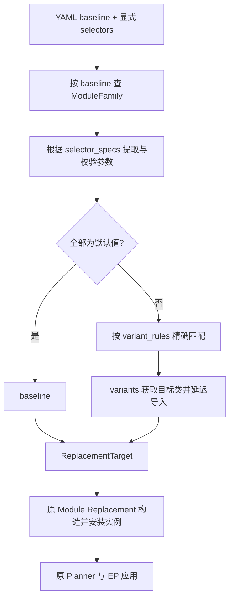
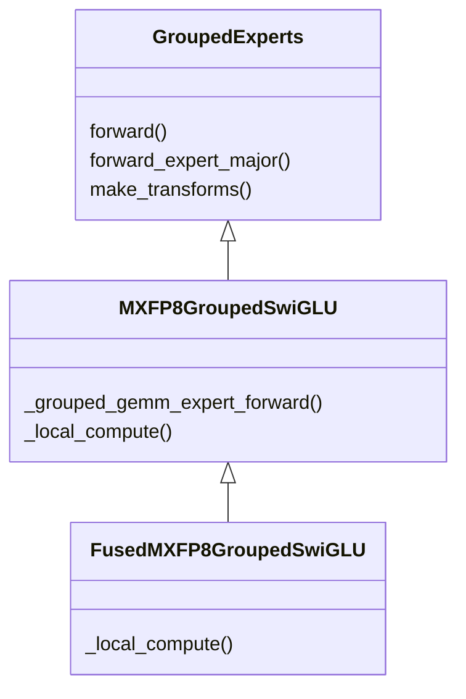
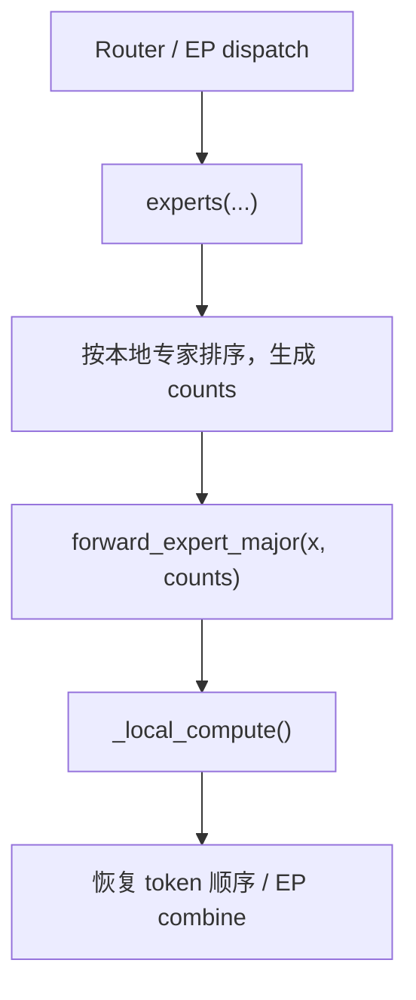

# Module Family 第一阶段设计：GroupedExperts 与 EP

## 1. 概述

Module Family 按模块族组织高性能模块的不同计算实现，在模型构建阶段根据配置完成选型。
用户通过统一的模块入口选择精度与融合能力，框架复用既有的模块替换、权重转换和并行执行流程。

GroupedExperts Family 提供三种实现：`GroupedExperts`、`MXFP8GroupedSwiGLU`、
`FusedMXFP8GroupedSwiGLU`。三者共享专家参数布局和调用接口。
本阶段仅支持 GroupedExperts Family；通用 QAT scheme 的 Family 入口留待后续实现。

| 组件 | 职责 |
| --- | --- |
| Module Family | 注册模块族，根据配置选择实现类 |
| Module Replacement | 匹配模型中的原模块，构造并安装替换实例 |
| GroupedExperts 及其子类 | 管理专家参数、权重转换和本地计算 |
| 并行执行器 | 生成分片计划，绑定本地计算入口，执行通信 |

## 2. 配置

在已有训练配置中加入以下片段，即可选择融合 MXFP8 Experts 并启用 EP=2：

```yaml
accelerator:
  tp_size: 1
  cp_size: 1
  pp_size: 1
  ep_size: 2
  sequence_parallel: false

plan_overrides:
  - match: "*.mlp.experts"
    module_type: transformers.models.qwen3_moe.modeling_qwen3_moe.Qwen3MoeExperts
    replace_module:
      _target_: hyper_parallel.components.modules.GroupedExperts
      use_mxfp8: true
      use_fused_mxfp8: true

  - match: "*.mlp"
    when: ep
    region_dispatch: false
    local_compute_fn:
      _target_: hyper_parallel.models.qwen3_moe.adapter.distributed.expert_parallel.qwen3moe_ep_compute_fn
```

`match` 指定原模块在模型树中的路径，`module_type` 校验源类型，`replace_module` 指定模块族和选择参数。
第二条规则为父 MoE 模块配置 EP recipe，由该 recipe 提供 Router 和输出组合规则。

### 2.1 实现选择

| `use_mxfp8` | `use_fused_mxfp8` | 选择结果 |
| --- | --- | --- |
| `false` | `false` | `GroupedExperts`，沿用模型配置的 dtype |
| `true` | `false` | `MXFP8GroupedSwiGLU` |
| `true` | `true` | `FusedMXFP8GroupedSwiGLU` |
| `false` | `true` | 配置错误 |

两个开关由该 Family 的 `selector_specs` 声明为布尔值，默认 `false`，作用范围为当前规则匹配到的 Experts。
非法 `false/true` 组合没有对应规则，在配置阶段报错。

### 2.2 专家并行配置

`use_grouped_gemm` 为 EP recipe 的可选参数：省略或 `null` 时按专家接口自动选择，
`true` 显式开启 grouped 计算，`false` 显式选择逐专家计算。
MXFP8 变体要求 grouped 计算，收到显式 `false` 时抛出配置错误。

MXFP8 Experts 的执行约束为 production 模式、TP=CP=PP=1、EP=1 或 2。
EP=2 时，专家总数须能被 2 整除，两组专家权重均沿专家维度使用 `Shard(0)`。

## 3. 构建流程



配置解析由 `parse_training_args()` 进入 `resolve_config()`。解析器遍历
`plan_overrides`，在 `Target` 类型字段且路径以 `.replace_module` 结尾时，调用
`_resolve_replacement_target()`。

### 3.1 注册与选型

`ModuleFamily` 以 baseline 类对象为键登记，保留原有 `name`、`baseline`、`variants`，
增加 selector schema 和完整具名规则：

```python
@dataclass(frozen=True)
class SelectorSpec:
    value_type: type
    default: Any

@dataclass(frozen=True)
class VariantRule:
    when: Mapping[str, Any]
    variant: str

@dataclass(frozen=True)
class ModuleFamily:
    name: str
    baseline: Callable
    variants: Mapping[str, str]
    selector_specs: Mapping[str, SelectorSpec] = field(default_factory=dict)
    variant_rules: tuple[VariantRule, ...] = ()
```

| 字段 | 职责 |
| --- | --- |
| `baseline` | 精确匹配的 callable；子类需单独注册 |
| `variants` | 变体名到完整 Python 导入路径的映射 |
| `selector_specs` | Family 自行声明 selector 名称、严格类型与 baseline 默认值 |
| `variant_rules` | 完整 selector 组合到已声明变体名的映射规则 |

GroupedExperts 的声明为：

```python
selector_specs = {
    "use_mxfp8": SelectorSpec(bool, False),
    "use_fused_mxfp8": SelectorSpec(bool, False),
}
variant_rules = (
    VariantRule({"use_mxfp8": True, "use_fused_mxfp8": False}, "mxfp8"),
    VariantRule({"use_mxfp8": True, "use_fused_mxfp8": True}, "fused_mxfp8"),
)
```

注册时检查 baseline 可调用且未重复登记、selector 名称非空、声明类型为 `type`、默认值类型准确。
每条规则必须具有全部且仅有该 Family 的 selector 字段，各值类型须与 schema 完全一致，
变体名须在 `variants` 中声明。相同条件（即使字段插入顺序不同）和 baseline 默认组合都不能重复登记。
仅传入原有三个字段的 Family 仍可注册，空 schema 对应 baseline，不推断隐含规则。
注册表复制调用方的 variants、schema 和规则条件，并以只读映射保存；注册后修改原始字典不会改变已校验的声明。

[选型函数][family] 保持公开接口：

```python
resolve_module_family_target(target, arguments) -> (callable, kwargs)
```

函数复制输入参数，从该 Family 的 schema 提取 selectors，再用默认值补齐有效组合。
所有 selector 均为默认值时选择 baseline；其它组合必须按字段名、完整键集合和取值匹配恰好一条规则。
未匹配时返回包含 Family、实际参数和合法组合的配置错误。
规则表表达融合与低精之间的依赖，通用解析器没有精度或融合参数名的专用分支。

类型按 `type(value) is value_type` 校验，布尔值不接受 `0/1` 或字符串 `"true"`。
选中的变体通过 `variants` 路径延迟导入，注册及 baseline 选择不导入低精实现。
所有 selector（包括显式 false）均从构造 kwargs 删除，其余参数按最终 callable 的签名和
`bind_partial()` 校验；存在 `**kwargs` 也不能吞掉未知配置键。
selector 名称只对当前 Family 生效。普通 target 显式声明的同名构造参数照常传递；
没有对应签名参数的未知键仍报错，不能借助 `**kwargs` 吞掉配置。

### 3.2 配置复制、覆盖与往返

[ReplacementTarget][target] 保存 `requested_target`、显式 selectors、最终 callable 和普通构造参数。
`get_family_selector_specs()` 从 baseline 动态取得 schema；`get_family_selector_spec(name)`
供 Target 级覆盖查询类型，覆盖值继续使用既有 `normalize_value()` 处理。

`replace(**changes)` 创建新对象并重新执行规则匹配，原对象保持不变。
`to_dict()` 保留原始 baseline 路径及用户显式填写的 selector：缺省 selector 不写入输出，
显式 false 会保留。用于匹配的有效默认值与需要序列化的显式值分别处理。
普通构造参数继续沿用原配置解析器的默认值补齐行为。

例如，对已解析的 replacement Target 进行 Python 覆盖：

```python
low = target.replace(use_mxfp8=True)
fused = low.replace(use_fused_mxfp8=True)
baseline = fused.replace(use_mxfp8=False, use_fused_mxfp8=False)
```

Target 级覆盖和 YAML/Python 往返均走同一 schema。根配置的列表路径解析沿用主线 resolver，
进入 replacement Target 后再按 selector schema 归一化，避免替换旧 resolver 而丢失主线已有的覆盖能力。

### 3.3 实例替换

Trainer 将 `plan_overrides` 整理为模块替换规则和并行规则。
模块替换规则通过 `ModuleReplacementSpec(match, module_type, factory)` 关联原模块与构造工厂。

[replacement 执行器][replacement] 匹配原实例，将其作为 `module` 参数传给工厂；
工厂经 `Target.build()` 调用选中类的构造器。主线的命名 dtype scheme 继续在
`entries_to_module_replacements()` 解析，经 factory 将强类型方案放入只读
`context["low_precision"]`；Family resolver 只选择类，不读取方案目录或探测设备。
`when: low_precision` 的禁用条目仍整体跳过，主线普通 QAT factory 保持自己的源参数身份与布局。
全局低精与并行组合的原保护继续保留，不能由 Family 绕过。
完成调用接口、参数和权重转换校验后，执行：

```python
parent._modules[name] = replacement
```

每个目标按“构造、校验、安装”的顺序处理。任一目标失败时终止构建，由调用方丢弃模型并重新创建。
替换完成后，planner 基于最终模块生成分片计划。

## 4. 模块与权重



基类维护参数和路由流程。`forward_expert_major()` 通过 `self` 调用
`_grouped_gemm_expert_forward()`；低精子类校验分组信息后调用 `_local_compute()`。
融合子类覆盖 `_local_compute()`，切换到融合计算。

MXFP8 变体接受无 bias、标准 SwiGLU 的三维专家权重。记专家数为 E、隐藏维度为 H、
中间维度为 I，H 和 I 须为 32 的倍数：

| 参数 | 持久布局 |
| --- | --- |
| `gate_up_proj` | `[E, H, 2I]` |
| `down_proj` | `[E, I, H]` |

[参数初始化][weights] 根据源参数状态处理权重：已有数值且需要转置时，创建目标参数并复制转置后的值；
布局一致时复用源参数；meta 构建保留形状和转换规则，由后续加载或初始化填值。
`make_transforms()` 描述 checkpoint 的可逆布局转换。构造过程保留模块训练状态和参数冻结状态。

## 5. EP 与融合计算

### 5.1 EP 本地接口



[EP binder][ep] 根据最终专家模块的 `forward_expert_major()` 接口选择 grouped 路径，
并通过统一的 forward rewriter 绑定本地入口。`experts(...)` 保留模块 hooks。

`counts` 表示每个本地专家的 token 数，包含零 token 专家；输入与输出保持 expert-major 顺序。
路由权重由外层在第二次 GMM 后应用一次。本地输出使用模型的 BF16/FP16 dtype。

[并行预检查][parallel] 在参数分片前检查实际 mesh 和最终 plan，核对专家轴分片、
EP recipe 及计算模式，错误信息包含对应模块路径。

### 5.2 融合计算与反向保存

非融合路径为 `MXFP8 GMM1 → SiLU / Mul → MXFP8 GMM2`。
模块构造时创建 `MXFP8GroupedLinear` 策略，两个投影共用它，通过公共
`_GroupedLinearFunction` 执行。每次调用将持久参数最后两维转置为策略要求的
`[E,O,K]` 视图；公共流程再转为 GMM 布局，反向返回对应布局梯度，由外层转置传回持久参数。
不缓存跨优化器步的量化权重，也不恢复旧的独立 GMM 引擎。
融合路径由一个 `_FusedGroupedSwiGLU` autograd Function 组织：

```text
前向：量化 X/W → GMM1 → SwiGLU + MXFP8 双轴量化 → GMM2 → Y
反向：量化 dY → GMM2 梯度 → SwiGLU 导数 + MXFP8 双轴量化 → GMM1 梯度
```

GMM 和融合激活分别调用设备算子。量化操作数采用 `MXFP8Tensor` 包装；
Function 对外返回普通 BF16/FP16 输出与梯度，仅支持一阶反向。

[融合 Function][fusion] 使用共享 `pack_quantized_operands()` 提取量化 payload 和 scale，
与 `counts`、GMM1 输出一起交给 `save_for_backward()`。反向读取物理张量后重建包装，
供 GMM 使用。空输入直接生成空输出及所需零梯度。

公共 GroupedLinear 同样在释放前向专用方向后保存反向所需的物理 payload/scale。
原始 counts 与归一化 offsets 都经 `save_for_backward()` 保存，以接受版本检查和保存 hooks；
ctx 的其它属性仅保留形状、dtype、设备、策略和重建元数据。每次反向独立重建包装，
不清空保留图仍需使用的存储。输入或权重冻结时，仅计算需要的梯度；空输入为可训练参数返回零梯度。
公共流程使用 `once_differentiable` 明确限制一阶反向。

设备适配器位于 `quantization/ops/npu_mxfp8.py`；融合能力检查和两个融合 kernel 的封装
也集中在此处，不在旧 `functional/npu_mxfp8.py` 路径维护第二份实现。

## 6. 代码位置

路径均相对 `hyper_parallel/`。

| 路径 | 入口 |
| --- | --- |
| `components/modules/family.py` | `SelectorSpec`、`VariantRule`、`ModuleFamily`、注册校验及 `resolve_module_family_target()` |
| `trainer/config/replacement.py`、`resolver.py`、`parallelism.py` | 配置解析、ReplacementTarget、替换规则构建 |
| `models/replacement.py` | 模块匹配、构造校验、实例安装 |
| `components/modules/grouped_experts.py`、`mxfp8_grouped_swiglu.py` | 权重契约、公开接口、本地计算 |
| `distributed/expert_parallel/experts.py`、`recipes.py` | EP 本地计算选择与绑定 |
| `distributed/_builder/module_family.py` | 并行组合与参数布局检查 |
| `components/quantization/functional/base_gmm_func.py`、`mxfp8_gmm_func.py` | 公共 grouped-linear 生命周期与 MXFP8 数值策略 |
| `components/quantization/functional/mxfp8_fused_grouped_swiglu.py`、`_saved_quantized.py` | 融合前反向、物理张量保存 |
| `components/quantization/ops/npu_mxfp8.py` | MXFP8 GMM 与融合激活的设备适配 |

[family]: ../../hyper_parallel/components/modules/family.py
[target]: ../../hyper_parallel/trainer/config/replacement.py
[replacement]: ../../hyper_parallel/models/replacement.py
[weights]: ../../hyper_parallel/components/modules/grouped_experts.py
[ep]: ../../hyper_parallel/distributed/expert_parallel/experts.py
[parallel]: ../../hyper_parallel/distributed/_builder/module_family.py
[fusion]: ../../hyper_parallel/components/quantization/functional/mxfp8_fused_grouped_swiglu.py

## 主线参数物化兼容

HSDP 在参数从 meta 设备物化或恢复存储时，通信缓冲区必须是脱离 autograd 的 Tensor。
`_refresh_sharded_local_tensor()` 对展平后的通信视图执行 `detach()`，继续与可训练的本地参数共享存储，
但不保留其 autograd 视图关系。这样参数同步或更新后，首次和后续 unshard 都能复用稳定的 Parameter，
同时正常计算梯度。该修复适用于主线 HSDP，不依赖 Module Family。
