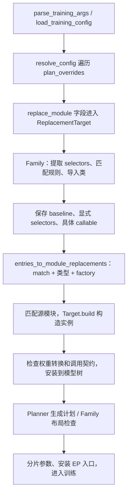
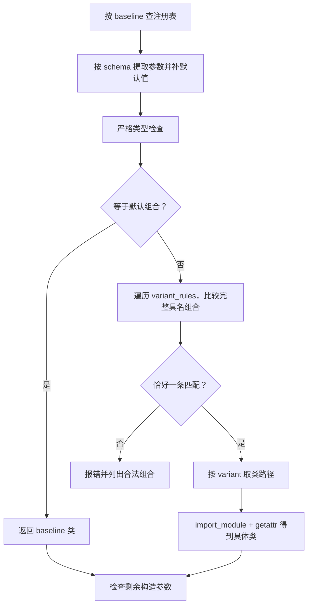
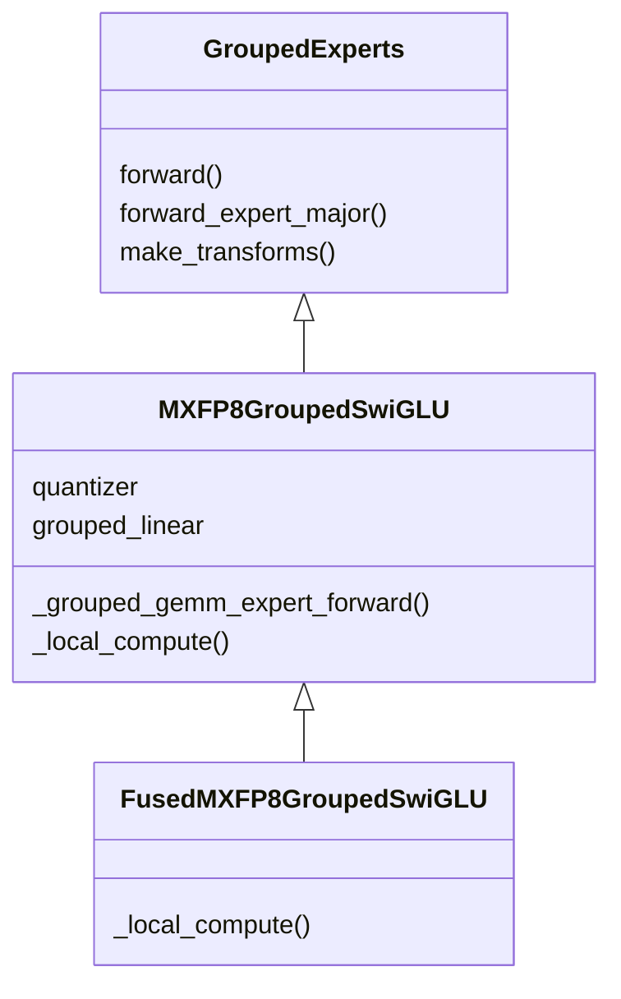
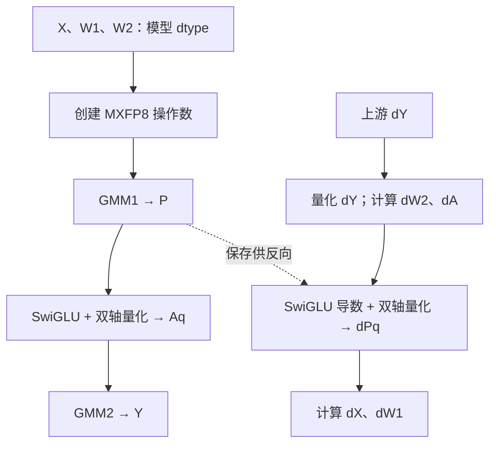
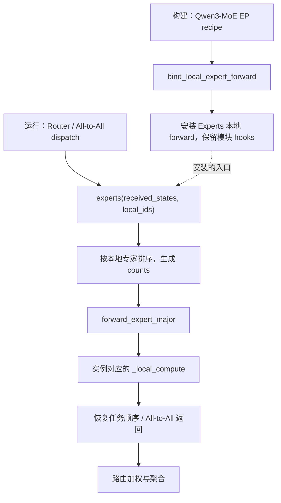

# Module Family 设计：规则选型、MXFP8 Experts 与 EP

源码版本：`5cd5f9ce17540997e71cdec60bb11796ddb47b23`，对应 PR #1214。

## 1. 总体设计

Module Family 将具有相同调用与参数契约的计算实现组织为一个模块族。用户指定统一的高性能模块入口及选择参数，框架在构建阶段选择实现，随后完成实例替换、权重处理和并行安装。

GroupedExperts Family 提供 `GroupedExperts`、`MXFP8GroupedSwiGLU`、`FusedMXFP8GroupedSwiGLU` 三种实现，共享专家参数布局和公开接口。

| 组件 | 职责 |
| --- | --- |
| Family 注册表 | 声明参数类型、默认值、合法组合和变体路径 |
| ReplacementTarget | 保存配置意图、选择具体类、支持复制和序列化 |
| Module Replacement | 匹配源模块，构造、校验并安装新实例 |
| GroupedExperts 及低精子类 | 管理权重契约、路由接口和本地计算 |
| Planner 与并行应用器 | 生成分片计划，校验布局，绑定 EP 计算入口 |
| 量化 functional 与 ops | 执行前反向、管理保存数据、适配设备算子 |

## 2. 配置接口

### 2.1 GroupedExperts 与 EP=2

以下片段加入已有训练配置，选择融合 MXFP8 Experts。模型、优化器和数据配置沿用训练工程。

```yaml
accelerator:
  tp_size: 1
  cp_size: 1
  pp_size: 1
  ep_size: 2
  sequence_parallel: false

plan_overrides:
  - match: "*.mlp.experts"
    module_type: transformers.models.qwen3_moe.modeling_qwen3_moe.Qwen3MoeExperts
    replace_module:
      _target_: hyper_parallel.components.modules.GroupedExperts
      use_mxfp8: true
      use_fused_mxfp8: true

  - match: "*.mlp"
    when: ep
    region_dispatch: false
    local_compute_fn:
      _target_: hyper_parallel.models.qwen3_moe.adapter.distributed.expert_parallel.qwen3moe_ep_compute_fn
```

`match` 匹配源模块路径，`module_type` 校验源类型。第一条规则替换子 Experts，第二条为父 MoE 模块指定 Router 和输出组合的 EP recipe。Family 使用上述两个开关选择固定的 MXFP8 实现；此示例无需启用 `training.low_precision`。

| `use_mxfp8` | `use_fused_mxfp8` | 具体实现 |
| --- | --- | --- |
| false | false | `GroupedExperts`，沿用模型 dtype |
| true | false | `MXFP8GroupedSwiGLU` |
| true | true | `FusedMXFP8GroupedSwiGLU` |
| false | true | 无对应规则，配置报错 |

两个参数的类型为 bool，默认 false，仅作用于命中的 Experts。省略值参与选型时补默认值；显式 false 在序列化中保留。

### 2.2 执行与覆盖契约

MXFP8 变体接受三维 packed、无 bias 的标准 SwiGLU，持久参数和输入使用匹配的 BF16/FP16 dtype；隐藏维和专家中间维为32的倍数。当前并行契约为 production 模式、TP=CP=PP=1、EP=1/2。

EP recipe 的 `use_grouped_gemm` 取值为 `None/True/False`：省略或 null 时检查 `forward_expert_major()`；true 显式选择 grouped；false 显式选择逐专家路径。低精变体要求 grouped，显式 false 会报错。

对已经解析的 replacement Target，可通过 Python 修改配置：

```python
low = target.replace(use_mxfp8=True)
fused = low.replace(use_fused_mxfp8=True)
baseline = fused.replace(use_mxfp8=False, use_fused_mxfp8=False)
```

每次修改创建新配置对象并重新选型，模型构建随后执行。当前接口支持 Target 级覆盖与 YAML/Python 往返；`plan_overrides.<index>` 的根配置列表索引 CLI 覆盖不在本版本接口范围内。

主线命名 dtype scheme 的配置和 factory 保持原有职责。本 Family 的两个 selector 固定选择 W8 MXFP8，不将 `low_precision_dtype_scheme` 用作数值策略选择；两类配置应使用各自的入口。

## 3. 构建流程



配置解析器在 Target 字段且路径以 `.replace_module` 结尾时调用 `_resolve_replacement_target()`。选类完成后，仍按最终 callable 的签名归一化普通构造参数。

`entries_to_module_replacements()` 将每条配置转换为 `ModuleReplacementSpec(match, module_type, factory)`。模型构建中的 replacement 执行器找到源实例，将 `module/module_fqn/context` 传给 factory；factory 调用 `Target.build()`，最终执行 `self._target_(**kwargs)`。

实例完成检查后，执行 `parent._modules[name] = replacement`。权重转换映射随之加入模型 checkpoint 元数据。替换先于参数分片，Planner 观察最终模块及参数。

每个目标按构造、校验、安装的顺序处理。发生错误时构建终止；调用方丢弃部分转换的模型后重新构建。

## 4. 声明式 Family

### 4.1 数据结构

```python
@dataclass(frozen=True)
class SelectorSpec:
    value_type: type
    default: Any

@dataclass(frozen=True)
class VariantRule:
    when: Mapping[str, Any]
    variant: str

@dataclass(frozen=True)
class ModuleFamily:
    name: str
    baseline: Callable
    variants: Mapping[str, str]
    selector_specs: Mapping[str, SelectorSpec] = field(default_factory=dict)
    variant_rules: tuple[VariantRule, ...] = ()
```

Family 以 baseline callable 的精确身份登记。`variants` 将变体名映射到完整 Python 导入路径；`selector_specs` 定义选择参数；`variant_rules` 声明完整具名组合。

GroupedExperts 的选择声明如下，变体路径分别指向两个低精子类：

```python
selector_specs = {
    "use_mxfp8": SelectorSpec(bool, False),
    "use_fused_mxfp8": SelectorSpec(bool, False),
}
variant_rules = (
    VariantRule({"use_mxfp8": True, "use_fused_mxfp8": False}, "mxfp8"),
    VariantRule({"use_mxfp8": True, "use_fused_mxfp8": True}, "fused_mxfp8"),
)
```

### 4.2 注册与解析

注册时复制 variants、schema 和规则条件，并以只读映射保存，隔离调用方原始字典的修改。随后检查 baseline、默认值、完整字段集合、规则取值类型、变体引用及重复条件。默认组合保留给 baseline，规则中不重复声明。



`_select_variant()` 使用 `type(value) is value_type` 校验。bool 不接受整数或字符串。规则按完整映射比较，不依赖字段插入顺序，不使用部分匹配或优先级。

`resolve_module_family_target(target, arguments)` 复制输入参数。选择参数被消费后，剩余参数按具体 callable 签名检查；`**kwargs` 不吸收未知键。`bind_partial()` 允许 `module` 等运行时参数稍后由 factory 注入。

普通 target 的同名显式构造参数按自身签名处理。变体延迟导入发生在选中后；注册和 baseline 选择不导入低精实现。设备能力在实际低精模块构造时检查。

### 4.3 配置对象

`ReplacementTarget` 保存四类信息：

| 字段 | 示例与用途 |
| --- | --- |
| `requested_target` | `GroupedExperts`，重新选型的起点 |
| `selectors` | 用户显式传入的开关，用于覆盖和往返 |
| `callable` | 本次选中的具体类，用于实例构造 |
| `_kwargs` | 去除 selector 后的普通构造参数 |

`replace()` 从原 baseline、已有参数和修改值创建新对象。`to_dict()` 保留原始 target 路径及显式 selector；有效默认值和用户显式值分别管理。

## 5. 专家模块与权重



`GroupedExperts.forward_expert_major()` 调用 `self._grouped_gemm_expert_forward()`；MXFP8 子类校验 counts 后调用 `self._local_compute()`。Python 按实例类型查找覆盖的方法，融合子类最终进入融合 functional。

记专家数为 E、隐藏维为 H、中间维为 I：

| 参数 | Family 持久布局 | grouped-linear 接口视图 |
| --- | --- | --- |
| `gate_up_proj` | `[E,H,2I]` | `[E,2I,H]` |
| `down_proj` | `[E,I,H]` | `[E,H,I]` |

源权重已加载且需转置时，构造器创建目标 Parameter，并在 `no_grad()` 下复制转置后的值；源布局相同时复用 Parameter。meta 构建由后续加载或初始化填值，`make_transforms()` 声明 checkpoint 的可逆转换。训练状态和 `requires_grad` 随源模块保留。

持久参数保持模型 dtype；量化操作数在计算时创建。无跨优化器步的量化权重缓存。

## 6. 本地计算与反向

### 6.1 非融合 MXFP8

构造器创建 `MXFP8Quantizer` 和 `MXFP8GroupedLinear(self.quantizer)`。两次投影共用这一策略对象，每次调用由独立 autograd ctx 保存所需数据。

```python
projected = _GroupedLinearFunction.apply(
    x, gate_up.transpose(-2, -1), counts, self.grouped_linear, 1)
gate, up = projected.chunk(2, dim=-1)
activated = F.silu(gate) * up
output = _GroupedLinearFunction.apply(
    activated, down.transpose(-2, -1), counts, self.grouped_linear, 1)
```

`_GroupedLinearFunction` 将前后向委托给 strategy。公共流程接收 `[E,O,K]` 权重视图，内部转为 GMM 布局；权重梯度按接口布局返回，再由外层转置传回持久参数。

### 6.2 融合 MXFP8

`FusedMXFP8GroupedSwiGLU._local_compute()` 调用 `fused_grouped_swiglu()`。一个 `_FusedGroupedSwiGLU` autograd Function 组织两次 GMM 及中间的激活／量化融合。



每个专家的计算为 `P=XW1`、`A=SiLU(Pgate)×Pup`、`Y=AW2`。反向分别计算 `dW2=AᵀdY`、`dA=dYW2ᵀ`、SwiGLU 导数、`dW1=XᵀdP` 和 `dX=dPW1ᵀ`，GMM 使用对应方向的量化操作数。

forward 融合封装调用 `npu_swiglu_mx_quant_with_dual_axis`；backward 调用 `_npu_swiglu_backward_mx_quant_with_dual_axis`。适配器集中位于 `quantization/ops/npu_mxfp8.py`，构造时检查两个算子均可用。

Function 对外使用普通 BF16/FP16 Tensor。量化 payload 与 scale 封装为 `MXFP8Tensor`；其逻辑 dtype 与底层 payload dtype 分别表达模型接口和物理表示。反向按 `.apply()` 输入顺序返回 `dX/dW1/dW2/None/None`，由 autograd 连接到参数和前序计算。

### 6.3 保存生命周期


每个操作数保留 `row_data/row_scale/col_data/col_scale` 四个稳定槽位，缺失方向使用 None。类型、逻辑 shape/dtype 和 quantizer 作为重建元数据保存。

公共 GroupedLinear 在释放前向专用方向后，保存反向所需物理数据，同时保存原始分组 Tensor 和归一化分组 Tensor。融合 Function 保存四个量化操作数、counts 和 GMM1 输出。每次反向读取保存数据后独立重建 wrapper，不消费保留图仍需使用的存储。

保存接口接受 autograd 版本检查及 saved-tensor hooks。两条路径通过 `once_differentiable` 限定一阶求导，支持在保留图时重复执行一阶反向。空输入返回空输出和所需零梯度，冻结输入或参数时仅计算需要的梯度。

## 7. EP 接入

### 7.1 安装与运行



EP binder 在应用并行计划时选择 grouped 路径，并通过统一 forward rewriter 安装本地入口。训练时通过 `experts(...)` 调用，保留模块 hooks 和参数准备边界。

`counts` 表示每个本地专家的 token 数，包含零 token 专家。输入和输出保持 expert-major 顺序；低精本地计算不应用路由权重，外层在 GMM2 后加权一次。collective 的 autograd 将梯度沿分发／返回关系反向传输。

EP=2 将 `[E,...]` 的专家维按 `Shard(0)` 分给两组 rank。分片改变本地持有的专家集合，GMM 的矩阵维度契约保持不变。

### 7.2 布局预检查

`validate_module_family_plan()` 在实际参数分片前检查最终模块、mesh 和 plan：production 模式、TP/CP/PP 均为1、EP=1/2且整除专家数；EP=2 时两组权重各有唯一的专家轴 `Shard(0)`，对应边界提供显式 `local_compute_fn`。

构造器检查源结构、激活、维度和算子能力；计划检查器核对实际切分；本地计算检查 counts 的形状和类型。验证条件按可用信息所在阶段执行。

## 8. HSDP 参数物化契约

HSDP 对物化后的本地参数维护通信用展平视图。`_refresh_sharded_local_tensor()` 对 `_sharded_param_data` 使用 `view(-1).detach()`，使通信视图与参数共享存储，同时脱离 autograd 视图关系；可训练的 `local_view` 继续绑定到参数并参与求导。

该处理覆盖带 padding 和无 padding 两条分支。参数同步或优化器更新对共享存储的写入，可被后续 unshard 读取，Parameter 身份保持稳定。此项属于公共 HSDP 存储契约。

## 9. 扩展方式与代码位置

新增 Family 时，实现符合源调用和权重转换契约的模块，登记 baseline、变体路径、selector schema 与完整合法组合。有限的实现选择进入规则；普通构造参数继续由最终类管理。当前生产登记为 GroupedExperts，测试中的第二个 Family 用于检验不同参数名和类型的通用解析。

所有路径相对 `hyper_parallel/`，链接固定到本文源码版本。

| 代码 | 入口 |
| --- | --- |
| [Family 注册与选型][family] | `register_module_family`、`_select_variant`、`resolve_module_family_target` |
| [ReplacementTarget][rt] | 配置保留、`replace`、`to_dict` |
| [配置解析器][resolver] | `_resolve_replacement_target`、`_replace_target_path` |
| [replacement factory][cfg] | `entries_to_module_replacements`、`_target_replacement_factory` |
| [模型替换][replacement] | `compile_module_replacements`、`apply_module_replacements` |
| [专家基类][experts] / [低精子类][low] | 权重、公开协议、本地计算 |
| [公共 grouped-linear][gmm] / [MXFP8 策略][strategy] | 前反向公共流程与格式实现 |
| [融合 functional][fused] / [物理保存][saved] | 融合前反向与保存恢复 |
| [设备适配][ops] | GMM 和融合算子封装 |
| [EP binder][ep] / [EP recipe][recipe] | 本地入口安装、通信调度 |
| [Family 计划检查][guard] / [应用入口][apply] | 切分前的组合校验 |
| [HSDP 参数存储][hsdp] | `_refresh_sharded_local_tensor` |

[family]: https://github.com/yooooo00/hyper-parallel-fork/blob/5cd5f9ce17540997e71cdec60bb11796ddb47b23/hyper_parallel/components/modules/family.py
[rt]: https://github.com/yooooo00/hyper-parallel-fork/blob/5cd5f9ce17540997e71cdec60bb11796ddb47b23/hyper_parallel/trainer/config/replacement.py
[resolver]: https://github.com/yooooo00/hyper-parallel-fork/blob/5cd5f9ce17540997e71cdec60bb11796ddb47b23/hyper_parallel/trainer/config/resolver.py
[cfg]: https://github.com/yooooo00/hyper-parallel-fork/blob/5cd5f9ce17540997e71cdec60bb11796ddb47b23/hyper_parallel/trainer/config/parallelism.py
[replacement]: https://github.com/yooooo00/hyper-parallel-fork/blob/5cd5f9ce17540997e71cdec60bb11796ddb47b23/hyper_parallel/models/replacement.py
[experts]: https://github.com/yooooo00/hyper-parallel-fork/blob/5cd5f9ce17540997e71cdec60bb11796ddb47b23/hyper_parallel/components/modules/grouped_experts.py
[low]: https://github.com/yooooo00/hyper-parallel-fork/blob/5cd5f9ce17540997e71cdec60bb11796ddb47b23/hyper_parallel/components/modules/mxfp8_grouped_swiglu.py
[gmm]: https://github.com/yooooo00/hyper-parallel-fork/blob/5cd5f9ce17540997e71cdec60bb11796ddb47b23/hyper_parallel/components/quantization/functional/base_gmm_func.py
[strategy]: https://github.com/yooooo00/hyper-parallel-fork/blob/5cd5f9ce17540997e71cdec60bb11796ddb47b23/hyper_parallel/components/quantization/functional/mxfp8_gmm_func.py
[fused]: https://github.com/yooooo00/hyper-parallel-fork/blob/5cd5f9ce17540997e71cdec60bb11796ddb47b23/hyper_parallel/components/quantization/functional/mxfp8_fused_grouped_swiglu.py
[saved]: https://github.com/yooooo00/hyper-parallel-fork/blob/5cd5f9ce17540997e71cdec60bb11796ddb47b23/hyper_parallel/components/quantization/functional/_saved_quantized.py
[ops]: https://github.com/yooooo00/hyper-parallel-fork/blob/5cd5f9ce17540997e71cdec60bb11796ddb47b23/hyper_parallel/components/quantization/ops/npu_mxfp8.py
[ep]: https://github.com/yooooo00/hyper-parallel-fork/blob/5cd5f9ce17540997e71cdec60bb11796ddb47b23/hyper_parallel/distributed/expert_parallel/experts.py
[recipe]: https://github.com/yooooo00/hyper-parallel-fork/blob/5cd5f9ce17540997e71cdec60bb11796ddb47b23/hyper_parallel/distributed/expert_parallel/recipes.py
[guard]: https://github.com/yooooo00/hyper-parallel-fork/blob/5cd5f9ce17540997e71cdec60bb11796ddb47b23/hyper_parallel/distributed/_builder/module_family.py
[apply]: https://github.com/yooooo00/hyper-parallel-fork/blob/5cd5f9ce17540997e71cdec60bb11796ddb47b23/hyper_parallel/distributed/apply.py
[hsdp]: https://github.com/yooooo00/hyper-parallel-fork/blob/5cd5f9ce17540997e71cdec60bb11796ddb47b23/hyper_parallel/core/fully_shard/hsdp_param.py
