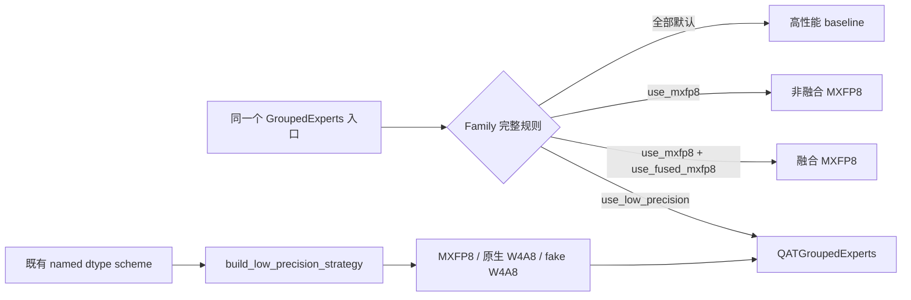
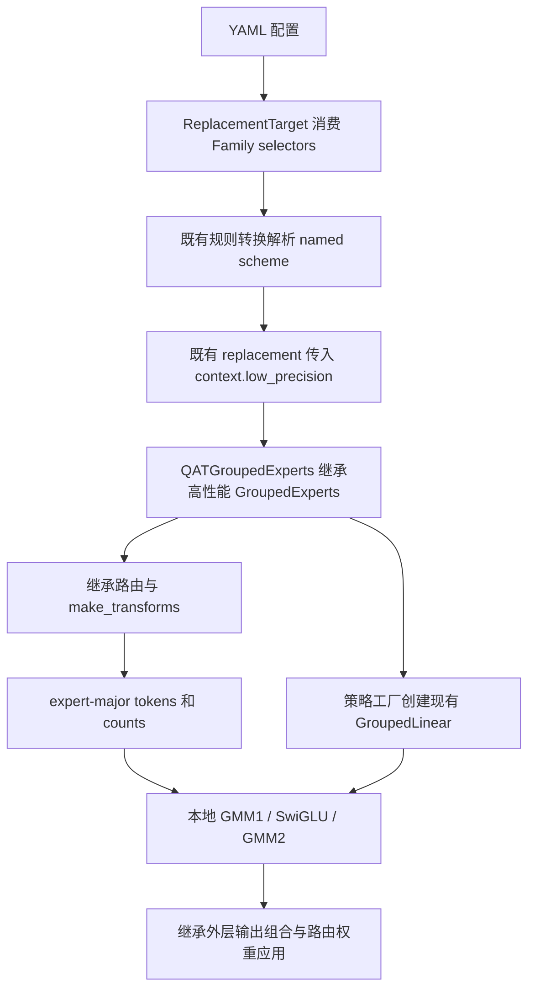

# QAT 接入 Module Family

日期：2026-10-20。依赖 Family/MXFP8 PR #1214；QAT 另开 PR，只提交适配代码和测试。
本文保存在个人 fork，独立于两份代码 diff。

## 设计

用户继续指定 `GroupedExperts`。Family 负责选实现，主线已有的 dtype scheme 负责选量化策略。
新增 `use_low_precision=true` 进入 `QATGroupedExperts`；不增加量化配置系统，也不复制 QAT 算子。



`use_low_precision` 与两个 MXFP8 专用选择参数互斥；冲突组合由 Family 白名单拒绝。
未指定的选择参数默认 false。QAT 本轮不与 SwiGLU 融合组合。

```yaml
training:
  low_precision:
    enabled: true
    dtype_schemes:
      experts_qat:
        weight_format: mxfp4
        act_format: mxfp8
        is_fake_quantize: true
        block_size: 32
plan_overrides:
  - match: "model.layers.*.mlp.experts"
    module_type: transformers.models.qwen3_moe.modeling_qwen3_moe.Qwen3MoeExperts
    exact_type: true
    when: low_precision
    low_precision_dtype_scheme: experts_qat
    replace_module:
      _target_: hyper_parallel.components.modules.GroupedExperts
      use_low_precision: true
```

这是以 Qwen3-MoE packed experts 为例、加入既有训练配置的片段。`when` 和 scheme 名字由现有配置解析器处理；关闭 low_precision 时该条替换规则不执行。
将 `is_fake_quantize` 改为 false 选择原生 W4A8；同时将 `weight_format` 改为 mxfp8 则选择 W8A8。

## 调用与权重



- 持久权重继续使用高性能布局：gate/up `[E,H,2I]`，down `[E,I,H]`。
- 调用公共 `_GroupedLinearFunction` 时通过可求导 transpose 转为其 `[E,O,K]` 契约；不增加持久权重副本。
- counts 是每个本地专家的 token 数，输出保持 expert-major；路由权重仍由父类外层应用一次。
- 非 meta 源权重的转置数值保持修复位于前置 Family PR；meta checkpoint/随机初始化仍走现有流程。
- QAT 不修改公共 GroupedLinear 生命周期，因而也不新增其重复反向、保存 hooks 或重算能力承诺。

改动只有：父类文件中的 Family 注册、`qat_grouped_experts.py` 适配类及测试。
EP、HSDP、planner、recipe、Trainer、量化算子与策略工厂均保持主线实现。
范围为三维 packed、标准无 bias SwiGLU、外层路由权重及 TP=CP=EP=PP=1。

## 本机验证与限制

基线：官方 `f14812d645a631ca659e7235988f1da0c132855a`。
依赖 Family 提交 `b63baaf652b9f5dda43c465be6b2e3fbd3eddd9c`。
QAT 实现提交 `f11c5793`。
环境：Ascend 950PR、Python 3.10.21、Torch 2.9.0、torch_npu 2.9.0.post7、CANN 9.2.0 beta.2。

CPU：88 passed、141 subtests passed。覆盖真实配置解析、策略选择、冲突、参数身份/冻结与转置数值保持。
A5：E=4、H=128、I=256，固定 expert-major 分组 `[16,0,16,32]`，含零 token 专家；SGD 各10步。
比较 Family 与直接策略调用的输出、输入/权重梯度、每步更新后的权重，要求 `rtol=0, atol=0`。

| 配置 | A5 结果 |
| --- | --- |
| MXFP8 W8A8，block32 | 10步通过，与直接策略路径精确一致 |
| 原生 W4A8，block32 | 10步通过，与直接策略路径精确一致 |
| fake W4A8，block32 | 10步通过，与直接策略路径精确一致 |
| 原生 W4A8，block128 | 失败：底层要求 E8M0 perTokenScale，当前路径提供 FP32 |
| fake W4A8，block128 | 失败：底层 scale 与 weight 转置契约不匹配 |

后两项在不使用 Family 的主线策略直接调用中也能复现。配置可选择不等于本机训练已通过；
不屏蔽失败，不静默回退，不修改公共算子来扩大本 PR。QAT PR 保持 Draft，block128 后续跟进主线修复。
未验证完整 Trainer、标准数据集收敛、多卡或更大模型。

```bash
python -m pytest -q tests/ut/components/modules/test_qat_grouped_experts.py
# 真实设备：当前主线预期为3 passed、2 failed；保留失败用于复现。
ASCEND_RT_VISIBLE_DEVICES=0 OMP_NUM_THREADS=2 python -m pytest -q -s \
  tests/torch/expert_parallel/_test_qat_family.py
```

先合入 Family/MXFP8，再将 QAT PR 转为上游评审；两份 PR 的代码边界保持独立。
