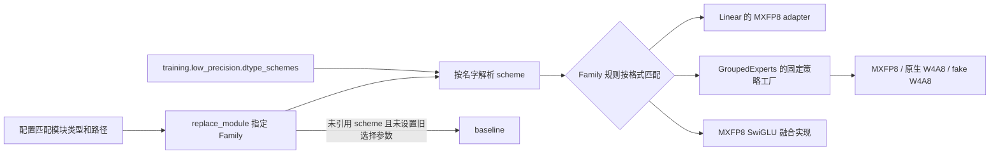
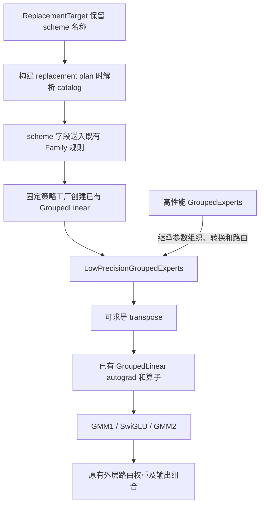

# 由 Module Family 选择低精计算策略

日期：2026-10-21。本文记录独立试验分支 `feat/module-family-scheme-config` 的实现和实测结果。
实现提交：`a826e3658296da87e56408614b23e7d20a340585`。
代码基于 Family/MXFP8 提交 `b63baaf652b9f5dda43c465be6b2e3fbd3eddd9c`，对应上游基线
`f14812d645a631ca659e7235988f1da0c132855a`。本文单独保存在 fork 的文档分支，不进入代码 PR。

## 配置与职责

新入口直接在 `replace_module` 下引用 `low_precision_dtype_scheme`。
Family 根据 scheme 的 `weight_format`、`act_format`、`is_fake_quantize` 选择实现；
`block_size` 交给选中的既有策略。不根据用户给 scheme 起的名字选择算子。

无需 `use_low_precision`、`when: low_precision` 或全局 `enabled: true`。
没有 scheme 时选择 baseline。原来的 `use_mxfp8` / `use_fused_mxfp8` 入口继续可用；
scheme 入口只需按需追加 `use_fused_mxfp8: true`，不要同时设置 `use_mxfp8: true`。



以下是可加入现有训练配置的片段。普通 Linear 与 packed experts 可以在同一配置中选择不同 scheme，
不需要往 DeepSeek 或其他模型适配文件中加入替换代码。模型仍须满足对应模块的计算与权重契约。

```yaml
training:
  low_precision:
    dtype_schemes:
      dense_w8:
        weight_format: mxfp8
        act_format: mxfp8
        block_size: 32
      experts_w4:
        weight_format: mxfp4
        act_format: mxfp8
        is_fake_quantize: true
        block_size: 32
plan_overrides:
  - match: "model.layers.*.self_attn.q_proj"
    module_type: torch.nn.Linear
    exact_type: true
    replace_module:
      _target_: hyper_parallel.components.modules.Linear
      low_precision_dtype_scheme: dense_w8
  - match: "model.layers.*.mlp.experts"
    module_type: transformers.models.qwen3_moe.modeling_qwen3_moe.Qwen3MoeExperts
    exact_type: true
    replace_module:
      _target_: hyper_parallel.components.modules.GroupedExperts
      low_precision_dtype_scheme: experts_w4
```

把 `is_fake_quantize` 改成 false，即选择原生 W4A8；再把 `weight_format` 改成 mxfp8，
即选择 MXFP8。只有 MXFP8 scheme 可以追加 `use_fused_mxfp8: true`。
普通 Dense Linear 本版仅接入既有 MXFP8 实现，不能选择 grouped W4A8 策略。

旧配置的 `when: low_precision` 和全局 enabled 开关继续保留原有“跳过替换”语义。
旧 `build_low_precision_strategy` 和模型专用 adapter 保留兼容；新 Family 路径不调用该工厂做选择。
移除的是此前 QAT 试验适配层的 `QATGroupedExperts` 和 `use_low_precision`，不是底层 QAT 计算实现。

## 实现边界



- `ReplacementTarget` 先保留 scheme 引用，待 catalog 可用后才选择实现；序列化保留原始名字。
- `Linear` baseline 继承 `nn.Linear`，直接保留源 weight/bias 和训练状态，不重新初始化权重。
- `LowPrecisionGroupedExperts` 接收已选定的策略，不内置策略筛选分支。
- 专家持久权重仍为 gate/up `[E,H,2I]`、down `[E,I,H]`；仅在 functional 边界转置到 `[E,O,K]`。
- counts 表示各本地专家的 token 数，局部输出保持 expert-major；路由权重由既有外层应用一次。
- 融合实现继续复用前置 Family PR 的物理 tensor 保存机制。QAT 公共 autograd 生命周期没有改写。
- 仅调整模块注册、适配层和 Trainer 配置转为 replacement plan 的连接处。
  EP、HSDP、Router、All-to-All、分片 planner 和量化算子没有修改。

GroupedExperts 范围仍为三维 packed、无 bias、标准 SwiGLU、GMM2 后应用路由权重，TP=CP=EP=PP=1。
未增加新的规则语言、插件层或通用量化抽象。不同模型可通过配置指定匹配类，但不能因此推断任意专家结构均已支持。

## A5 实测

环境：Ascend 950PR，驱动 `25.1.rc1.b087`，CANN `9.2.0 beta.2`，Python `3.10.21`，
Torch `2.9.0+cpu`，torch_npu `2.9.0.post7+gitddd16dd`，Transformers `5.12.0`。
本轮使用独立 venv `/home/c00913822/hp-family-scheme-venv`，editable 安装指向本轮 worktree。

CPU：93 passed、142 subtests passed。使用真实配置解析、Trainer plan 归一化和 replacement 执行入口；
仅替换设备能力探测，覆盖选择、参数身份、转置值、混合 scheme、配置冲突、未知参数及旧入口回归。

| 路径 | A5 结果 | 10 步实际算子调用 |
| --- | --- | --- |
| Linear baseline | 10 步通过 | 普通 BF16 Linear |
| Linear MXFP8 | 10 步通过 | 30 次 MXFP8 MatMul |
| GroupedExperts MXFP8，block32 | 10 步通过 | 60 次 GMM |
| GroupedExperts 原生 W4A8，block32 | 10 步通过 | 60 次 GMM |
| GroupedExperts fake W4A8，block32 | 10 步通过 | 60 次 GMM |
| GroupedExperts MXFP8 scheme + 融合 | 带固定 top-k 路由，10 步通过 | 60 次 GMM，融合前向/反向各 10 次 |
| 原生 W4A8，block128 | 未通过 | perTokenScale 为 FP32，算子要求 E8M0 |
| fake W4A8，block128 | 未通过 | scale 与 weight 转置契约不匹配 |

每条通过的路径都对照其已有直接实现，逐步比较输出、输入梯度、权重梯度和更新后的权重，
沿用 QAT 接入测试的 `rtol=0, atol=0`，结果精确一致。这个结论指“新配置接入没有改变对应实现”，
不表示 W4A8、MXFP8 和 BF16 彼此没有量化误差。

专家局部测试用 E=4、H=128、I=256、64 个 routed tokens、counts=`[16,0,16,32]`；
Dense 用 `[64,128]` 输入和 128→256 投影。使用固定随机种子和 SGD。
融合 scheme 测试使用 64 个输入 token、top_k=2、固定路由权重 `[0.25,0.75]`。
这是算子/模块级训练回归，数据为固定随机张量，不是标准语料，也不是完整 Trainer 收敛验证。

两项 block128 失败，在本轮环境中绕过 Family、直接调用既有策略也再次复现。
保留失败用例，不标记成通过，不增加静默 BF16 回退。
另运行前置非融合/融合模块的 6 项 A5 回归，全部通过；两个新增 launcher 也通过实测。
未验证本版 QAT 的多卡、完整 Trainer 或真实数据集收敛。

静态检查：新增/修改代码的 pylint 错误检查通过。
完整 AutoGit 检查仍被父类已有的两处 Args 文档缺失及 `astroid` 拼写误报阻断；没有为消除这些报告扩大父类改动。

## 复现命令与日志

```bash
cd /home/c00913822/hyper-parallel-family-scheme-20261021
source /home/zhaoyu65/cann-9.2.0/ascend-toolkit/set_env.sh
export PATH=/home/c00913822/hp-family-scheme-venv/bin:$PATH
export OMP_NUM_THREADS=2
export HF_HUB_OFFLINE=1 TRANSFORMERS_OFFLINE=1
export HTTP_PROXY=http://127.0.0.1:7893 HTTPS_PROXY=http://127.0.0.1:7893
export ALL_PROXY=http://127.0.0.1:7893
python -m pytest -q \
  tests/ut/components/modules/test_qat_grouped_experts.py \
  tests/ut/components/modules/test_linear_family.py \
  tests/ut/components/modules/test_grouped_experts_family.py \
  tests/ut/components/modules/test_module_family_selectors.py \
  tests/ut/trainer/test_module_family_replacement.py \
  tests/ut/dual_mode_dtensor/test_module_replacement.py \
  tests/ut/trainer/test_config_overrides.py \
  tests/ut/models/deepseek_v3/adapter/test_qat_replacements.py \
  tests/ut/components/quantization \
  tests/ut/auto_models/models/qwen3_moe/test_replacements.py
# 包含两个已知 block128 失败：合并运行时应为 6 passed、2 failed。
ASCEND_RT_VISIBLE_DEVICES=0 python -m pytest -q -s \
  tests/torch/expert_parallel/_test_qat_family.py \
  tests/torch/expert_parallel/_test_linear_family.py
# 既有 6 项回归。
ASCEND_RT_VISIBLE_DEVICES=0 python -m pytest -q -s \
  tests/torch/expert_parallel/_test_family_mxfp8_local.py
# 验证正常 torchrun launcher。
ASCEND_RT_VISIBLE_DEVICES=0 python -m pytest -q \
  tests/torch/expert_parallel/test_linear_family.py \
  tests/torch/expert_parallel/test_qat_family.py::test_scheme_fused_mxfp8
```

本机日志目录：`/home/c00913822/hp-validation/family-scheme-20261021/`。
其中 `cpu.log`、`a5-strategies.log`、`a5-fused-regression.log`、`a5-launchers.log` 和
`direct-block128.log` 分别记录 CPU、基础策略、新融合配置及既有回归、launcher 与直接策略复现。
